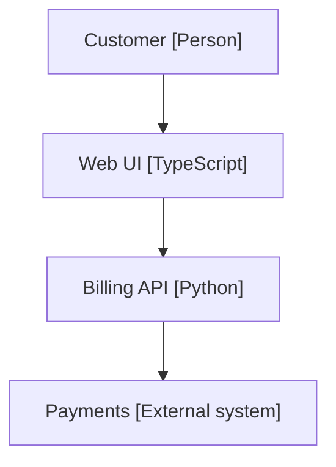

# The architecture document standard

One architecture document per system, with a fixed skeleton, two required diagrams and a
technology inventory, checked by a dependency-free linter. This page is the standard for a
repository that adopts Sigma. It is not Sigma's own architecture; that is
[architecture.md](architecture.md).

## What this is

The document answers "what is this system made of, and why" in one place a reader and an agent
can both find. It is arc42-lite: eleven sections, a system-context diagram and a container diagram
drawn as Mermaid `flowchart` blocks with C4 naming, and a table naming the technology of every
container. `architecture_doc.py lint` checks the structure; it does not judge the content.

## The skeleton

Eleven level-2 headings, each present exactly once:

1. **Context and scope**: who uses the system and which external systems it talks to; holds the
   system-context diagram.
2. **Constraints**: what the design may not change (platforms, regulation, deadlines).
3. **Solution strategy**: the few decisions that shape everything else.
4. **Building blocks**: the containers; holds the container diagram.
5. **Runtime view**: how the important requests flow.
6. **Deployment**: where each container runs.
7. **Cross-cutting concepts**: logging, configuration, security and the like.
8. **Decisions**: links to the decision records.
9. **Quality requirements**: the measurable qualities the system must keep.
10. **Risks and technical debt**: what is known to be fragile.
11. **Technology inventory**: one row per container, naming its technology.

Matching is case-insensitive, on level-2 (`##`) headings outside code fences, with an optional
leading number (`## 4. Building blocks` counts). Order is not enforced. A heading that appears
twice is a finding.

## Required diagrams

Two diagrams are required: a Mermaid `flowchart` under **Context and scope** (the system-context
diagram) and one under **Building blocks** (the container diagram). Requiring both goes slightly
beyond "every heading is present", because a missing diagram is otherwise invisible.

Draw C4 as a flowchart and name each node `id["Name [Technology]"]`:



- The technology is the text inside the **last** `[...]` of the label, so
  `cache["Cache [v2] layer [Redis]"]` is the container `Cache [v2] layer` written in Redis. Put
  the technology last: `web["Web UI [TypeScript] serves [beta] pages"]` reads as the container
  `Web UI [TypeScript] serves` written in `beta`.
- A line break in a label (`<br>`, `<br/>`, `<br />`) counts as a space, so
  `web["Web UI<br/>[TypeScript]"]` is the container `Web UI`.
- A node whose technology is `Person` or `External system` is not a container and needs no row.
- A node with no `[Technology]` at all is a finding.
- The label forms read are `id["..."]`, `id("...")`, `id{{"..."}}`, `id[...]` and the shaped forms
  `id[("...")]`, `id(["..."])`, `id[["..."]]`, `id(("..."))`, `id[/"..."/]`, `id[\"..."\]`,
  `id[/"..."\]` and `id[\"..."/]`; the shape punctuation is not part of the name. A node defined on an edge line (`web["..."] --> api["..."]`) is read too. An id is
  letters, digits and `_` (any script, so `café[...]` counts) joined by single hyphens. A
  `subgraph` title is not a container, nor is anything on a `%%` comment line, in edge text
  `-->|...|`, or on a `click`, `style`, `classDef`, `class`, `linkStyle` or `direction` line. When
  an id is defined twice, the first definition is the one read.
- Mermaid's own C4 keywords (`C4Context`, `C4Container`, `C4Component`, `C4Dynamic`,
  `C4Deployment`) are reported as unsupported: that syntax is experimental and not rendered by
  every host, while `flowchart` is.
- Every flowchart under Building blocks is read as a container diagram, not only the first: each
  of its nodes needs a Technology inventory row unless its technology is Person or External
  system. An extra flowchart there (a deployment sketch, a sub-flow) will produce findings; put it
  under another heading.

Under **Technology inventory**, the first table lists each container by the exact name used in
its label (trimmed and case-folded; no partial match, so a row `Billing API Gateway` does not
cover `Billing API`). Only the first table counts, its header row is not a container, and a cell
written bold (`**Web UI**`), as a link (`[Web UI](architecture.md)`) or as code
(`` `Web UI` ``) is read without that wrapper:

```markdown
| Container | Technology |
| --- | --- |
| Web UI | TypeScript |
| Billing API | Python |
```

Other diagrams (sequence, state, entity-relationship, class) are welcome in the other sections;
every ```` ```mermaid ```` block must open with a supported keyword: `flowchart`, `graph`,
`sequenceDiagram`, `stateDiagram-v2`, `erDiagram` or `classDiagram`. A leading `%%` comment and
a leading `---` front-matter block are skipped.

Bracket and quote balance is checked per line: on each line the counts of `[` and `]`, `(` and
`)`, and `{` and `}` must match and the number of `"` must be even, counted over the whole line,
quoted label text included. So a label cannot hold a lone bracket; write `&#91;` for a literal
`[`. Braces are not counted in `erDiagram`, `classDiagram` and `stateDiagram-v2` blocks, where
they open multi-line bodies. `subgraph` and `end` must pair in a flowchart (only there: a
sequence diagram closes `loop` and `alt` with `end` too). A code fence (of any kind) left open at
the end of the file is a finding, `unclosed-fence`, because everything after it reads as code.

## Where the document lives

The system document lives at `architecture.system_root` (default
`docs/architecture/architecture.md`). In a monorepo that is one folder; in a multi-repo system it
is the system repository, and each service keeps its own document in `docs/architecture/` in its
own repository (or `services/<name>/docs/` in a monorepo).

This standard describes service documents but scaffolds and lints only the system document: there
is no second skeleton per service. `lint <dir>` accepts any directory that holds an
`architecture.md`, so a service document can be linted the same way.

`architecture.system_root` is one key in `.sdlc/config.json` (see the
[configuration reference](configuration.md)). It is either a repository-relative folder (no
absolute path, no `..` segment, and its real location must stay inside the repository) or a
repository URL starting `https://`, `ssh://` or `git@`. A folder may not hold a control character
(a newline, say). A URL is shape-checked only (at most 2,048 characters, no whitespace or control
character, a host of letters, digits, `.` and `-` with an optional `:port`, and a repository path
after it): the linter prints `existence not checked (no network)` and never reads the network.

## Rules live in the north-star

The numbered architecture rules belong to the product north-star, not to this document. Rules
live in the north-star: keep the numbered architecture rules in the north-star, link this document
in one line, copy neither; nothing can detect copying, so this is a convention.

## The lint gesture

```sh
python3 skills/sigma-init/scripts/architecture_doc.py lint <dir>
```

It reads `<dir>/architecture.md` and exits `0` when clean, `1` with one finding per line, or `2`
for a usage error or a file it will not read (unreadable, larger than 1 MiB, not a regular file,
or a symlink that leaves the directory). A finding reads `<file>:<line>: [<code>] <message>`; line
`0` means the whole file. Pass the folder, not the file: `lint path/to/architecture.md` is a
`missing-file` finding that says the target is not a directory. The codes are `missing-file`, `missing-heading`, `duplicate-heading`,
`missing-diagram`, `unsupported-keyword`, `no-keyword`, `unbalanced-bracket`,
`unbalanced-subgraph`, `node-no-technology`, `container-no-inventory`, `line-too-long`,
`unclosed-fence` and `system-root`.

Without `<dir>` it lints the folder `architecture.system_root` resolves to; when that value is a
repository URL there is no local folder to read, so `lint` with no `<dir>` exits `2` and asks you
to run it inside that repository or pass a directory. Two more verbs:
`resolve` prints the resolved root and its form, `folder`, `url` or `invalid` (exit `0`, or `1`
for `invalid`, with the error on the next line; a value holding a control character, or one that
is not a string, is printed as JSON), and `headings` prints the eleven headings. The optional flags are `--repo-root` (default: the current directory) and
`--sdlc` (default: `<repo-root>/.sdlc`). The config flag is spelled `--sdlc`, as in
`preflight.py`; do not lengthen it, because the longer spelling is a retired placeholder that the
private-name guard rejects.

## Honest limits

- This is a structural check, not a Mermaid renderer. A diagram that lints clean can still fail
  to render in some host.
- A repository URL in `architecture.system_root`: existence not checked (no network).
- Windows paths are not supported: a drive-letter (`C:`) or UNC (`\\host\share`) value is refused
  with the absolute-path message, and the linter is not measured on Windows.
- An unreadable or missing `.sdlc/config.json` falls back to the default `docs/architecture` and
  says so in one stderr line; with an explicit `<dir>` that line ends
  `architecture.system_root not checked`, so a clean exit is never read as a clean bill for the key.
  The line appears every time you lint from a directory without a Sigma config.
- Folder existence is checked only for a value you set explicitly. A value equal to the default
  `docs/architecture` counts as unset, so a repository that has not created the document yet does
  not fail `lint <dir>` on the key, while `lint` with no directory still exits 1 naming the missing
  `docs/architecture/architecture.md`.
- The label reader is line-oriented: a label that spans lines, or a node syntax not listed above,
  can hide a container. In particular Mermaid 11's shape syntax, `db@{ shape: cyl, label: "Orders
  DB [PostgreSQL]" }`, is not read: such a node is silently not checked, so use `db[("...")]`.
  Edge text written as `A -- text(x) --> B` can be misread as a node; use the `-->|text|` form.
- A space between the id and its bracket, `q ["Queue [Kafka]"]`, is not read as a node, so that
  container is silently not checked; write `q["Queue [Kafka]"]`.
- The asymmetric shape `q>"Queue [Kafka]"]` is reported as `unbalanced-bracket`, because its `>`
  opens what only a `]` closes; use another shape.
- Only the six keywords above are supported: `stateDiagram` (version 1), `flowchart-elk`, `pie`,
  `gantt` and every other diagram type are reported as `no-keyword`. Use `stateDiagram-v2` and
  `flowchart`.
- Headings are read line by line, so a `## Constraints` line inside a multi-line HTML comment
  (`<!--` ... `-->`) still counts as the heading (and as a duplicate if the real one follows).
- The balance rule applies to sequence-diagram message text too, so `A->>B: retry (up to 3`
  is a finding although Mermaid renders it; close the bracket.
- An unreadable `.sdlc/config.json` includes one that is not a regular file (a named pipe, say),
  which is never opened, so it cannot hang the lint, and one larger than 1 MiB, which is not
  parsed.
- A line longer than 4,096 characters is a finding and is not otherwise checked.
- Only a table whose rows start with `|` is read as the inventory. A table written without leading
  pipes (`Container | Technology`) is not read, so every container is reported as having no row;
  start each row with `|`.
- Only `##` headings are read. A Setext heading (the text on one line, `---` under it) is not, so
  `Constraints` underlined that way is reported as a missing heading; write `## Constraints`.
- Only a value starting with lowercase `https://`, `ssh://` or `git@` is a repository URL. Any other
  value, `http://...` or `HTTPS://...` included, is read as a folder, so it is reported as a folder
  that does not exist, with a reminder of the URL forms.
