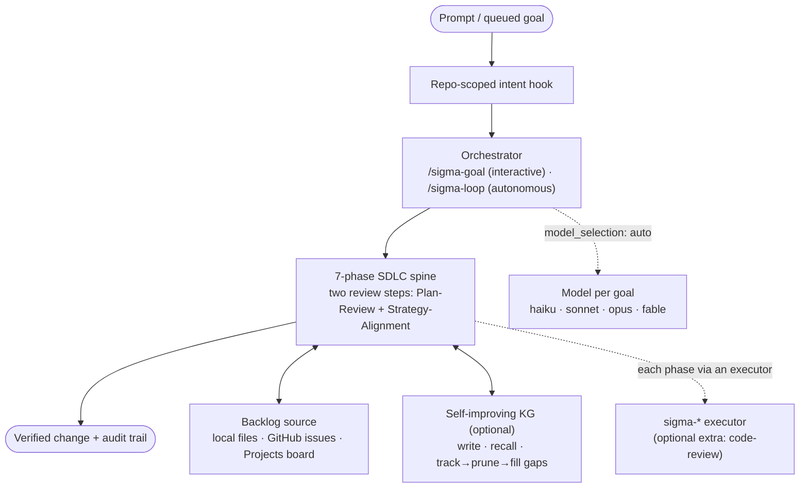
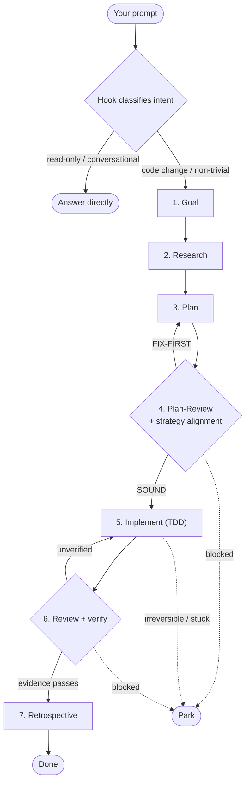
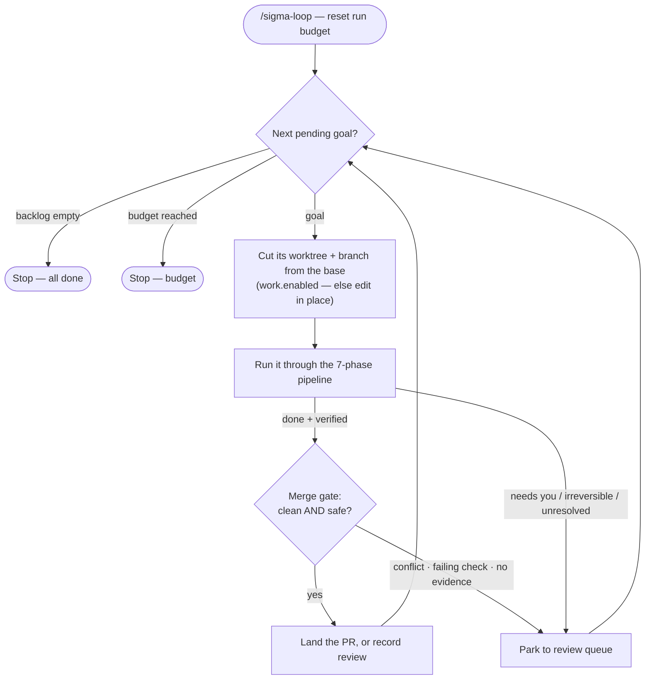

# Architecture

How the hooks, phases and loop fit together. Back to the [README](../README.md).

## How it works

Sigma registers 10 hook commands (see `hooks/hooks.json`); each is fail-open. The prompt gate (`hooks/sigma_gate.sh`, wired as a `UserPromptSubmit` hook) is
**scoped per repo**: it only speaks in a project that has adopted the spine (an `.sdlc/` directory
exists — i.e. you ran `/sigma-init`); in any other repo it is a silent no-op, so installing the
plugin machine-wide never injects policy into unrelated projects. Set `SIGMA_GATE_GLOBAL=1`
to restore the old always-on behavior everywhere. Every other Sigma hook (the PreToolUse and Stop
gates) is likewise inert outside an adopted repository — no `.sdlc/config.json`, no effect. In an
adopted repo, on every prompt the prompt hook classifies intent with fast, deterministic regex —
**no LLM** — and injects the matching SDLC directive:

- **code change / implementation** → "do NOT jump to editing; run the full spine from the GOAL and
  pass PLAN-REVIEW before any edit."
- **read-only / conversational** → "answer directly (say so) — but the moment it becomes a code
  change, switch to the spine."
- **anything else** → the standard 7-phase policy.

The hook is *advisory and fail-safe*: a false positive over-reminds, a false negative falls back to
the standard policy, and it always emits valid JSON (even on garbage or empty stdin). It never calls
out, never blocks — it shapes what the agent does next.

## Architecture & flow

Threat boundaries, assets, and the mitigations currently present are recorded in
[the threat model](threat-model.md).

### The pieces

### How a prompt falls through the phases

A prompt enters through the repo-scoped prompt hook, which routes by intent. Code work then falls through the
seven phases — with two **gates** that can send it back, and a **park** exit for anything that needs you:

### How the autonomous loop runs the backlog

The loop runs the backlog **park-and-continue** — it parks whatever needs you and keeps going:

With `work` off, the two extra boxes collapse: the loop edits in place and never touches git, exactly
as it did before.
