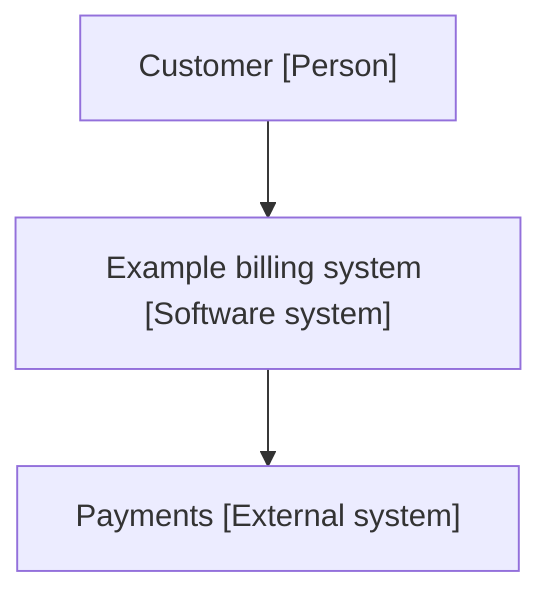
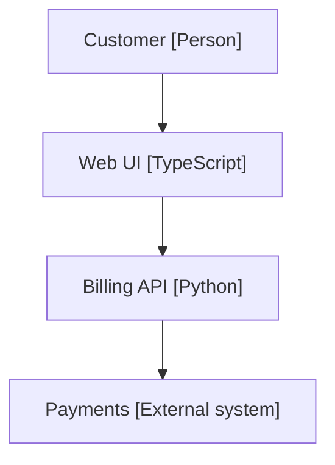

# Architecture: Example billing system

## Context and scope

Who uses the system and what it talks to.

## Constraints

Python 3.10 or newer; no network at lint time.

## Solution strategy

A web front end over one billing service.

## Building blocks

The containers.

## Runtime view

How a request flows.

## Deployment

One container host.

## Cross-cutting concepts

Logging and configuration.

## Decisions

See the decision records.

## Quality requirements

Bills are never lost.

## Risks and technical debt

The payments provider is a single dependency.

## Technology inventory

Every container and its technology.

| Container | Technology |
| --- | --- |
| Web UI | TypeScript |
| Billing API | Python |
